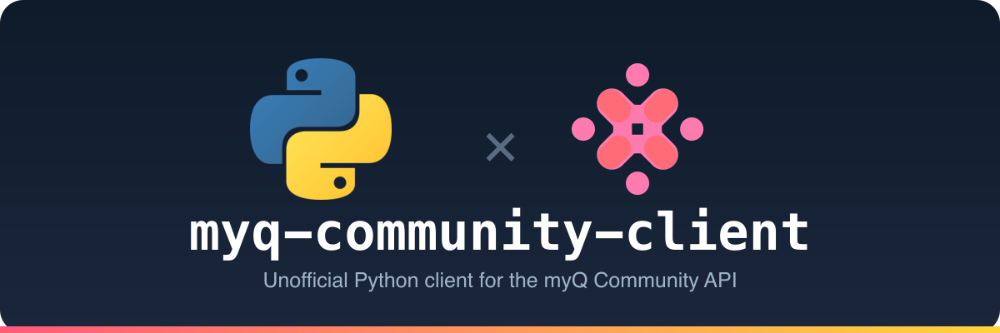

<p align="center">
  
</p>

<p align="center">
  <a href="#installation"></a>
  
  
  
</p>

A clean, unofficial **Python client for the Chamberlain myQ Community API** —
log in, list your communities and devices, **unlock doors & gates**, and read
access history. Fully headless (no browser), with automatic token refresh.

For personal interoperability with hardware **you** control.

> ⚠️ **Disclaimer** — This is an independent, unofficial project. It is **not
> affiliated with, authorized, or endorsed by Chamberlain Group / myQ**. "myQ" and
> "myQ Community" are trademarks of their respective owners; the mark in this
> project's banner is a recolored, non-brand placeholder. Use only with your own
> account and devices, and respect myQ's Terms of Service. No warranty.

---

## Features

| Capability | Status |
|---|---|
| Headless login (email + password) | ✅ verified live |
| Multi-factor auth (SMS **and** email OTP) | ✅ verified live |
| Token auto-refresh **+ rotation** persistence | ✅ verified live |
| List communities | ✅ verified live |
| List devices (locks, gates, access panels) | ✅ verified live |
| **Unlock / open** a door, gate, or lock | ✅ verified live |
| Access / unlock **history** | ✅ verified live |
| Works across device types & multiple communities | ✅ routed by family |

## Installation

```bash
pip install -e .          # from a clone; the only dependency is httpx
```

## Quick start

myQ Community uses **OAuth2 (Authorization Code + PKCE)** with mandatory MFA on
most accounts. This client drives the whole login in Python and handles the
one-time code via a callback — **no browser needed**.

```python
from myqcommunity import MyQCommunity

def get_code(challenge):
    # challenge.method is "sms" or "email"; .masked_phone / .masked_email say where
    return input(f"Enter the code sent to {challenge.masked_phone or challenge.masked_email}: ")

myq = MyQCommunity.login("you@example.com", "password", otp_callback=get_code)

for community in myq.communities():
    print(community.name, community.id)
    for lock in myq.locks(community.id):
        print("  ", lock.name, lock.serial_number, "online:", lock.online)
        myq.unlock(community.id, lock)          # 🔓 open it

    for ev in myq.history(community.id, limit=20):
        print(ev.timestamp, ev.event, ev.device_name)
```

### Stay logged in (fully headless after the first time)

The first login returns a **refresh token**. Save it and reuse it forever — no
password or OTP on subsequent runs. **myQ rotates the refresh token on every
refresh, so you must persist the new one each time** (the client does the
mechanics; you just supply a save callback):

```python
import json
from myqcommunity import MyQCommunity

def save(tok):
    json.dump({"refresh_token": tok.refresh_token}, open("token.json", "w"))

# later runs:
rt = json.load(open("token.json"))["refresh_token"]
myq = MyQCommunity.from_refresh_token(rt, on_token_refresh=save)
```

The client auto-refreshes before expiry and on a `401`. See
[`examples/login_and_unlock.py`](examples/login_and_unlock.py) for a complete CLI
that stores the token in `~/.myqcommunity_token.json`.

## Compatibility with other myQ Community setups

Designed to work beyond a single account:

- **Any device type.** `unlock(community_id, device)` routes by device family —
  `access_panel` gates/doors use the panels-host `/doors/{serial}/unlock`;
  `remote_lock` smart locks use the devices-host `/devices/{serial}/actions/unlock`.
  Pass a `Device` and it picks the right call; pass a bare serial and it tries both.
- **Multiple communities & paginated devices/history.**
- **MFA variants** (SMS / email / none) and wrong-code retries.
- **Regions / deployments** — override `MyQCommunity(hosts={...})` and
  `identity_host=` if your account lives elsewhere.
- **Forward-compatible** — every model keeps the raw JSON in `.raw`.

## API reference

Endpoints, auth flow, hosts, and request / response shapes are documented in
[`API_REFERENCE.md`](API_REFERENCE.md).

## Development

```bash
python -m pytest tests/        # 17 offline unit tests — no account needed
```

Covers PKCE, login-form parsing, MFA detection, model parsing, unlock routing /
fallback, and history cursor pagination.

## License

[MIT](LICENSE). Not affiliated with Chamberlain Group / myQ.

---

## Tested devices & contributing

This client has been **tested live against an `access_panel` gate**
(`device_type: access_panel_door`) — login, MFA, token refresh, listing, unlock,
and history all confirmed working on that device.

**Other device types have not been tested yet.** `remote_lock` smart locks and
any other families are implemented from the known API shape and routed by device
family, but they haven't been exercised on real hardware.

If something doesn't work for your setup, or you need a fix or a new feature —
**please open an issue or send a PR.** Helpful details: your device's
`device_family` / `device_type`, the request path involved, and the HTTP status /
response body you got (with any tokens or personal info redacted).
